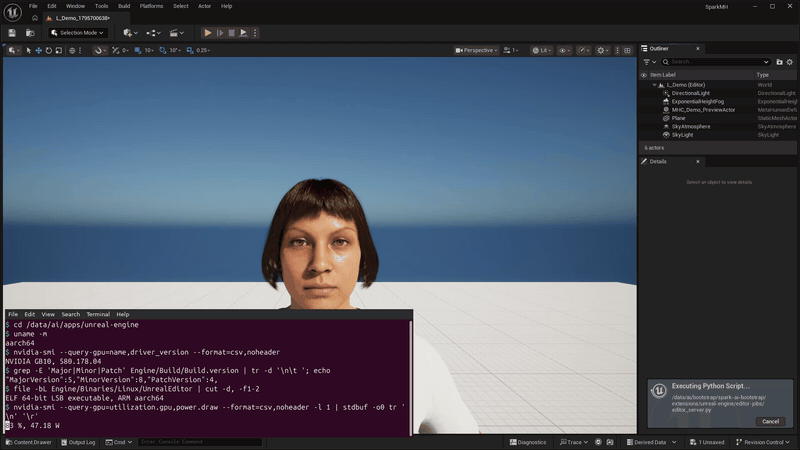

# Unreal Engine 5.8 editor + MetaHuman, native on NVIDIA DGX Spark (Linux ARM64)



**Videos** ([playlist](https://www.youtube.com/playlist?list=PLKsl-5CUsf7E)):
- [The 55-second demo](https://youtu.be/yLzT4niN044): one take, the MetaHuman in the editor and, in the same take, a terminal with
  `uname -m` = aarch64, `nvidia-smi` = NVIDIA GB10, engine 5.8.4, the editor binary's architecture and the GPU load.
- [Claude builds a MetaHuman over MCP](https://youtu.be/MzfLHV3oMGE), in 32 s, real time.
- [DeepSeek, running locally on the same Spark, does the same](https://youtu.be/rZRpoam8SD0), shown at 8x speed.

The Unreal Engine 5.8.4 editor, built from source and running natively on the DGX Spark's GB10 (aarch64, Vulkan). It
has the GUI with all 187 default engine plugins built and loaded, the MetaHuman Creator with Epic's cloud auto-rig, Lumen
with hardware ray tracing, and a packaged arm64 game. It also runs Epic's own MCP server, through which an AI agent
creates and edits a MetaHuman in the running editor, including a local model (DeepSeek V4.1 Flash) running on the same
Spark. No x86 emulation anywhere.

| | |
|---|---|
| Engine | Unreal Engine 5.8.4 (`release` commit `f45729c0`), plus 32 commits on the `dgx-spark-arm64` branch of my fork |
| Machine | NVIDIA DGX Spark: GB10 (10× Cortex-X925 + 10× Cortex-A725, Blackwell GPU), 121 GiB unified memory, Ubuntu 24.04 |
| MetaHuman close-up, Lumen with **hardware ray tracing** | **~79 fps** in the editor viewport (GPU 11.7 ms) |
| Same, Lumen with software ray tracing / no dynamic GI | ~80 fps / ~94 fps |
| Packaged arm64 game | built, cooked and packaged on the Spark; **115–121 fps** on the OpenWorld template level |
| From nothing to the editor | **29 min** with `build.sh` in an empty folder: downloads (toolchain + 22 GB of Epic dependencies), arm64 libraries, 3440 compile actions at 20 jobs |
| From the editor to a packaged game | 19 min with `tools/package.sh` (build, cook, stage, pak) |
| Editor start | 15–20 s with a warm shader cache; 4.5–7.5 min the first time (shaders compile from scratch) |
| AI agent over MCP | Claude Code (Sonnet 5.5), through Epic's experimental ModelContextProtocol plugin: a MetaHuman created from one prompt, shaped, checked and opened in its editor in **32 s** |
| Local model over MCP | DeepSeek V4.1 Flash (Q2, SSD streaming, via DwarfStar) on the same Spark, beside the editor, through `tools/mcp/local_agent.py`: the same MetaHuman task in **7 min 55 s**, 15 turns, no errors, no cloud API |
| Memory in use, whole machine | peaks of 23 GiB building at 20 jobs, 38 GiB cooking, 27 GiB with the editor on the MetaHuman scene (sampled every 30 s with `free`) |

How the fps were measured:
- **Editor:** the realtime viewport, about 1520×905 inside a 1920×1080 window, at the default 85% screen percentage
  (1293×769 rendered). The scene is a stock MetaHuman Creator character with grooms, with the camera orbiting the head
  for 25–40 s. Frame times come from the editor's own tick, with no vsync and no frame cap. While the screen is being
  recorded (x11grab + NVENC), the same orbit runs at ~70 fps.
- **Game:** the engine's CSV profiler (`tools/run-game.sh`), 1400×788 rendered in a 1920×1080 window, Lumen with
  hardware ray tracing.

## What works

Each item was checked on the machine. The checks are the jobs in `tools/editor-jobs/jobs`, run inside the editor.

- **The editor with its GUI**, Vulkan on the GB10 (SM6, Nanite, Lumen, virtual shadow maps).
- **Play In Editor** and **`UnrealEditor -game`**.
- **Hardware ray tracing.** The GB10's Vulkan driver exposes the ray tracing extensions. A GPU profile shows the scene
  build, Lumen's hardware ray tracing passes (direct lighting, screen probes, reflections) and hair ray tracing.
- **MetaHuman Creator:**
  - a character created from the template, with grooms and an outfit from the plugin's wardrobe;
  - assembled for preview and placed in a level;
  - the Creator's own editor UI;
  - **the cloud auto-rig** ("Create Full Rig": joints and blend shapes), through Epic's service. The Epic account login
    is a device code: the editor opens `epicgames.com/activate?userCode=…`, and that page works in any browser (I
    logged in from another computer). The rig came back about a minute after the login, and the rigged face plays the
    Creator's facial range-of-motion animation.

  Everything except the auto-rig runs locally.
- **All 187 default engine plugins build and load**, including SpeedTree (built from the sources in the engine tree),
  Perforce (Perforce's own aarch64 API) and Python scripting (system Python 3.12). "Load" means the editor starts with
  every one of them enabled and logs no load failure. The features I tested by hand are the ones on this list.
- **ISPC kernels** compiled for NEON with Intel's aarch64 ISPC 1.24.0, the version Epic bundles for x86_64.
- **FBX import** through ufbx (static meshes, skeletal meshes, skeletons, animations), and **audio import** (libsndfile).
- **The embedded web browser (CEF / Chromium 147):** the Fab window opens and browses inside the editor.
- **The NNE editor's ONNX tools**, through my own implementation of their small C interface (Epic ships only binaries).
- **NDI® output**, with the NDI SDK's own aarch64 runtime (6.4):
  - the editor sends its level viewport as an NDI source (`tools/editor-jobs/jobs/job_ndi.py`);
  - a separate receiver process built with the NDI SDK (`tools/ndi/ndi_recv_check.cpp`) finds the source on the
    network and receives 1520×904 frames at 60 fps (1202 frames in 20 s);
  - once the capture stops, the source is gone.
- **Blackmagic (DeckLink) plugin:** it builds for arm64, loads, and its DeckLink API layer initializes. Capture itself is
  not tested (see below).
- **Packaging a game for arm64 on the Spark itself**, with Epic's own BuildCookRun (`tools/package.sh`): build, cook,
  stage, pak, archive. The game runs at 115–121 fps (see above).
- **Epic's MCP server** (the experimental ModelContextProtocol plugin, with the Editor and MetaHuman toolsets). It needed
  no engine change: it builds and runs on arm64 as Epic ships it.
  - The server starts with the editor on `http://localhost:8000/mcp`, bound to the loopback address only. It offers
    about 25 toolsets: actors, assets, Blueprints, materials, the level, meshes, the editor itself, MetaHuman.
  - `tools/mcp/mcp_check.py` does the MCP handshake and calls tools, with no dependencies.
  - Claude Code (Sonnet 5.5) ran on another computer, through an SSH tunnel, with only the three MCP tools allowed. From one English
    prompt it created a MetaHuman, set her height, build, skin tone and eye colour, read every value back, and opened
    her in the MetaHuman Creator, in 32 s ([video](https://youtu.be/MzfLHV3oMGE)).
  - **With a local model, no cloud API.** `tools/mcp/local_agent.py` (standard library only) offers the editor's MCP
    tools to any OpenAI-style endpoint with tool calling. With DeepSeek V4.1 Flash served by
    [DwarfStar](https://github.com/antirez/ds4) on the same Spark, the same task with the same values gave the same
    result: 15 turns, no failed call, every value read back, the Creator opened ([video, 8x](https://youtu.be/rZRpoam8SD0)). The harness adds a five-line system
    prompt that explains the three MCP tools (including "use the tool's short name").
    - 2 runs, 2 successes: 7 min 55 s with a 52 GiB expert cache, 13 min 13 s with 20 GiB; 9 to 69 s per turn.
      Claude Code also built and opened the MetaHuman in both of its runs.
    - Memory: DeepSeek held about 71 GiB and the editor with the Creator open about 20 GiB, leaving 27 GiB free.
- **Reproducible from scratch.** On 26 Nov 2026 I replayed the whole guide twice, each time in an empty folder:
  - the branch made from Epic's source archive plus the commits;
  - then only `build.sh` and `tools/package.sh`, with fresh downloads and caches;
  - the second replay, with the first 30 commits: 29 min to a working editor, 19 min to a packaged game, the game at
    121 fps, and every editor check passing again.

  The last two commits (Blackmagic, NDI) came after that replay. They were built on the same tree and checked the same
  way.

## What doesn't work (yet)

- **FBX export and Datasmith CAD import.** The Autodesk FBX SDK and TechSoft HOOPS Exchange are closed-source and ship
  for x86_64 Linux only. FBX import is covered by ufbx; export and CAD import are not.
- **Blackmagic capture and playout: not tested.** There is no DeckLink card or Blackmagic driver on the Spark.
- **No Zen server.** Epic's Zen storage server and zen tool ship for x86_64 Linux only:
  - the derived-data cache runs on local files (`-ddc=NoZenLocalFallback`);
  - the cook writes loose files instead of a Zen store (`bUseZenStore=False`).
- **Two display quirks with no window manager** (`tools/display`, for a headless machine):
  - maximize does nothing, so windows are placed with `tools/display/xinput.py place`;
  - the editor must not throttle itself in the background (`DefaultEditorSettings.ini`, written by `build.sh`).

## Requirements

**Hardware.** An aarch64 Linux machine with an NVIDIA GPU and its Vulkan driver. I used an NVIDIA DGX Spark; other GB10
machines should behave the same, but I haven't tried them. You need about 150 GB of free disk. For memory, the
whole machine peaked at 23 GiB building at 20 jobs, 27 GiB with the editor on the MetaHuman scene and 38 GiB cooking
a game. So 32 GB is enough to build and run the editor, and packaging a game needs 48 GB or more. Every GB10 machine
has 128 GB; I haven't run it on less.

**Exact versions** (`tools/versions.sh` prints this table):

| Component | Version |
|---|---|
| Unreal Engine | 5.8.4 (CL 55116800), `release` commit `f45729c0` + the `dgx-spark-arm64` branch |
| OS | Ubuntu 24.04.5 LTS (DGX OS), kernel 7.0.0-1019-nvidia, glibc 2.39 |
| GPU, driver | NVIDIA GB10, driver 580.178.04 |
| CUDA | 13.0 (driver API), toolkit 13.0.3 (not used by the engine) |
| Vulkan | NVIDIA ICD API 1.4.312, loader 1.4.328.1 |
| Clang (engine build) | LLVM 20.1.8, official aarch64 release, libc++ linked statically |
| .NET SDK (UnrealBuildTool) | 10.0.404 |
| ISPC | 1.24.0 (Intel's aarch64 build) |
| CEF | 147.0.5+g68529a5 (Chromium 147.0.7727.49), public linuxarm64 build |
| Python (editor scripting) | 3.12.3 (system) |
| CMake (third-party libraries) | 3.28.3 |
| NDI SDK (optional) | 6.4.0.2 |
| Xorg (headless display) | 21.1.12 |

**System packages.** On DGX OS everything was already installed, and I never needed root. For a bare Ubuntu 24.04
arm64, this is the list I derived from what the 1302 arm64 binaries link and load at run time. I haven't tried it on a
bare install yet.

```bash
# build
sudo apt install build-essential cmake python3-dev curl xz-utils bzip2 file patch git
# editor run time (Vulkan, SDL/X11, the CEF browser, audio, Python, NDI discovery)
sudo apt install libvulkan1 libx11-6 libx11-xcb1 libxcursor1 libxext6 libxfixes3 libxi6 libxrandr2 libxss1 \
  libxkbcommon0 libxcomposite1 libxdamage1 libnss3 libnspr4 libatk1.0-0t64 libatk-bridge2.0-0t64 libcups2t64 \
  libdrm2 libgbm1 libpango-1.0-0 libcairo2 libasound2t64 libfontconfig1 libsndfile1 libpython3.12t64 libavahi-client3
# only for a headless machine (tools/display) and screen recording
sudo apt install xserver-xorg-core x11-utils libxtst6 ffmpeg
```

## Step by step

1. **Get the engine source**: the `dgx-spark-arm64` branch of my fork (see [The fork](#the-fork-with-the-engine-patches)).
2. **Build** (toolchain, Epic's dependencies, arm64 libraries, the editor):
   ```bash
   ./build.sh --engine UnrealEngine --jobs 20
   ```
3. **Only on a headless machine:** an X screen on the GPU, no root needed.
   ```bash
   tools/display/display.sh start
   ```
4. **Run the editor** with the sample project `build.sh` created:
   ```bash
   UE_ENGINE=UnrealEngine tools/editor.sh gui
   ```
5. **Optional: package a game and measure it.**
   ```bash
   UE_ENGINE=UnrealEngine tools/package.sh
   UE_ENGINE=UnrealEngine tools/run-game.sh
   ```
6. **Optional: NDI.** Download the "NDI SDK for Linux" from <https://ndi.video>, accept its licence, unpack it, and
   build with `NDI_SDK_DIR` set to its folder:
   ```bash
   NDI_SDK_DIR="/path/to/NDI SDK for Linux" ./build.sh --engine UnrealEngine thirdparty build
   ```
   Epic bundles the NDI runtime for x86_64 Linux only, and it isn't mine to redistribute.
7. **Optional: drive the editor from an AI agent over MCP.** The sample project starts Epic's MCP server with the
   editor, on `http://localhost:8000/mcp`. From another computer, open a tunnel and add the server to your MCP client
   (here Claude Code):
   ```bash
   ssh -N -L 8000:localhost:8000 your-spark &
   python3 tools/mcp/mcp_check.py          # handshake and tool list
   claude mcp add --transport http unreal http://localhost:8000/mcp
   ```
   Any MCP client with HTTP transport works the same way. The server has no authentication: keep it on loopback.

   **With a local model on the same Spark**, serve it on port 8000 (DwarfStar's `ds4-server`, OpenAI-style API with
   tool calling) and move the editor's MCP server to 8100:
   ```bash
   ./ds4-server --cuda -m DeepSeek-V4.1-Flash-1017-IQ2_XXS-Q2_K-imatrix.gguf --host 127.0.0.1 --port 8000 \
     --ctx 32768 -n 1024 --ssd-streaming --ssd-streaming-cache-experts 52GB &   # the exact flags of the tested run
   UE_ENGINE=UnrealEngine tools/editor.sh gui \
     "-ini:EditorPerProjectUserSettings:[/Script/ModelContextProtocolEngine.ModelContextProtocolSettings]:ServerPortNumber=8100" &
   python3 tools/mcp/local_agent.py --mcp http://localhost:8100/mcp \
     --prompt "Create a new MetaHuman at /Game/MCP/Vera, 172 cm tall, ..."
   ```
   Set the expert cache explicitly. By default DwarfStar sizes it from the machine's total memory, and with the
   editor running that doesn't fit.

What `build.sh` does. Each step skips work that is already done and can be run alone (`toolchain deps thirdparty uba
build`):

1. **toolchain:** downloads, pinned and checksummed:
   - .NET 10.0.404 for linux-arm64;
   - LLVM's clang 20.1.8 for aarch64 (the only clang major UE 5.8 accepts);
   - Intel's ISPC 1.24.0 for aarch64;
   - the public linuxarm64 CEF 147 build.
2. **deps:** builds GitDependencies for arm64 and fetches Epic's binary dependencies for Linux (about 22 GB).
3. **thirdparty:**
   - lays out an Epic-style toolchain folder around clang 20 + libc++ (static, like Epic's builds) with the host glibc;
   - builds for aarch64, from the sources in the engine tree, the libraries Epic ships for x86_64 only:
     DXC/ShaderConductor, hlslcc, SPIRV-Reflect, VHACD, metis, Kiss FFT, etc2comp, the astcenc thunks, ISPCTexComp,
     SpeedTree, the CEF wrapper, the Blackmagic dispatcher.
4. **uba:** builds UnrealBuildAccelerator's host library for arm64. UBT 5.8 runs every action through UBA, and Epic
   ships it for x64 only.
5. **build:** the editor, ShaderCompileWorker and EpicWebHelper, for a sample project with every default plugin plus
   MetaHuman, Blackmagic, NDI and Epic's MCP server (ModelContextProtocol, EditorToolset, MetaHumanGenerator). The project settings are what Epic's templates set on Linux (SM6, Lumen), plus
   hardware ray tracing.

The tools in `tools/`:
- `editor-jobs/`: a small job runner inside the editor (Python), plus the checks I ran: scene, orbit fps, lighting
  modes, ray tracing, FBX, audio, the Creator UI, PIE, NDI.
- `mcp/mcp_check.py`: a minimal MCP client (handshake, tool list, tool calls) to check the editor's MCP server.
- `mcp/local_agent.py`: a minimal agent, a local model driving the editor through MCP, with a timestamped log.
- `display/`: the X server without root, input via XTest, screen recording with NVENC.
- `versions.sh`: the versions table above.

## Known issues

- The first editor start compiles shaders for several minutes.
- The editor links a generated stub of the FBX SDK. Code that calls the SDK directly (the legacy FBX importer, FBX
  export) gets nothing back.
- The editor log notes that the sample project's file "requires update" for the Blackmagic plugin's platform list. It's
  harmless.
- With no window manager, editor windows open at a fixed size and need placing (`xinput.py place`).
- The MCP plugin is experimental. Its editor screenshot tool (`CaptureEditorImage`) returns the PNG as base64 text
  rather than as an MCP image, so a client can't look at it. This is in the plugin, not in the port.

## The fork with the engine patches

The engine changes are 32 commits on the `dgx-spark-arm64` branch of my fork of Epic's repository, one commit per
problem: <https://github.com/Grant-Wishes/UnrealEngine/tree/dgx-spark-arm64>.

Epic's license lets engine source, modified or not, go only to other Unreal Engine licensees. So the fork is visible
only to GitHub accounts linked to an Epic Games account. To link yours, follow Epic's instructions at
<https://www.unrealengine.com/ue-on-github>. Then:

```bash
git clone --branch dgx-spark-arm64 --depth 1 https://github.com/Grant-Wishes/UnrealEngine.git UnrealEngine
```

This repository holds only my own scripts, notes and measurements: no engine code, no MetaHuman assets, and no
third-party SDK files.

## Prior work

I'm not the first to try this, and this port builds on what others found:
- **Neodaysoff** opened the [Epic forum request](https://forums.unrealengine.com/t/feature-request-official-unreal-editor-linux-arm64-aarch64-support-for-nvidia-dgx-spark-gb10/2731250)
  in June 2026. Their UE 5.4 bring-up reached a native ShaderCompileWorker and many editor modules, and their post maps
  the walls clearly.
- **MrQbit**'s [unreal-dgx](https://github.com/MrQbit/unreal-dgx) (July 2026) got much further on UE 5.4. Its editor
  boots and runs headless. It packages games for arm64, and cross-builds them for x86_64/SteamOS, from the Spark. It
  also has GameForge, a pipeline that generates assets locally and drives the editor through its own Remote
  Control-based MCP server.

| | MrQbit/unreal-dgx (Jul 2026) | This port |
|---|---|---|
| Engine version | 5.4 | 5.8.4 |
| Compiler | system clang 18 | LLVM clang 20.1.8 (the version UE 5.8 requires), libc++ static like Epic's Linux builds |
| Editor with GUI | not reached (commandlets, headless) | yes |
| MetaHuman | not attempted | Creator, local preview, ~79 fps with hardware ray-traced Lumen, cloud auto-rig |
| Packaged game | yes: a code-only Pong sample, for arm64 and cross-built for x86_64/SteamOS | arm64: the OpenWorld template level with hardware ray-traced Lumen, 115–121 fps |
| ISPC | off (C++ fallbacks) | on (NEON) |
| ISPC texture compressor | stub | built for arm64 |
| CEF web browser | off | on (Chromium 147) |
| FBX import | stub, non-functional | ufbx |
| SpeedTree / Perforce | rebuilt from source / disabled | built from source / Perforce's aarch64 API |
| AI agents over MCP | its own MCP server over Remote Control, plus the GameForge pipeline (headless editor) | Epic's ModelContextProtocol plugin in the GUI editor, tested with Claude Code |

## How I worked

I started because I wanted Unreal and MetaHuman on the Spark for a side project, and there was no complete port. The
ideas and the decisions are mine; the execution was done with Claude Opus 5.5 in Claude Code: builds, logs, patches.
More than once it concluded that a wall couldn't be climbed (SpeedTree, NDI, Blackmagic, the cloud auto-rig), and I
pushed it to keep digging. Every claim here was checked on the machine. The longer story is in the
[article](docs/index.md).

## License

My scripts and tools are MIT licensed (see `LICENSE`). Unreal Engine is © Epic Games and is not included here; the
engine changes are only on the fork, for Unreal Engine licensees. NDI® is a registered trademark of Vizrt NDI AB, and this
port is not affiliated with or endorsed by NDI or Epic Games.

## Contact

Stuck with something on GB10 or ARM64? Write to me at grantwishes.contact@gmail.com, or open a thread in this
repository's [Discussions](https://github.com/Grant-Wishes/ue5-dgx-spark-arm64/discussions).
