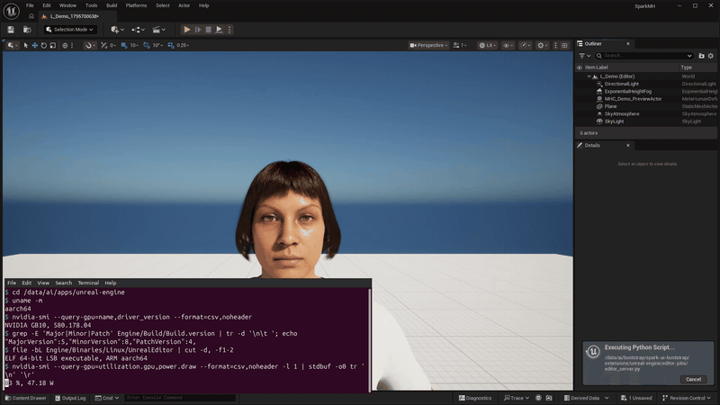

# Unreal Engine 5.8 editor + MetaHuman, native on NVIDIA DGX Spark (ARM64): how I did it

## "Not supported"

In June 2026 Neodaysoff asked on the Unreal Engine forums for "official or experimental" Unreal Editor support on
Linux ARM64 for the NVIDIA DGX Spark. They wanted it to run Epic's official ModelContextProtocol plugin, so that a local
AI agent could drive the editor. Their own UE 5.4 attempt had reached a native ShaderCompileWorker and many
editor modules. The walls they listed were x86-only toolchain assumptions, the build accelerator, FBX, USD, OpenEXR,
Opus and the ISPC texture compressor. As of 27 November, nobody from Epic has answered. Before that, years of threads about
Jetson boards, Raspberry Pis and AArch64 workstations end the same way: it isn't supported, so it can't be done.

The public attempts I found were all on UE 5.4. MrQbit's unreal-dgx (July 2026) boots the editor headless, packages
games for arm64 and SteamOS, and drives the editor from an AI chat through its own MCP server; the GUI editor was
still to do. In mid-November, JimmyToluene's ue5-dgx-spark built on that patch and got the editor window rendering,
with Lumen and Nanite. I wanted three things: the current engine, the complete editor with every default plugin, and
MetaHuman. And then the thing the thread actually asked for: Epic's MCP plugin.

## The result

<iframe src="https://www.youtube-nocookie.com/embed/yLzT4niN044" title="Unreal Engine 5.8 editor + MetaHuman on NVIDIA DGX Spark (ARM64)" style="width:100%;max-width:960px;aspect-ratio:16/9;border:0" allow="accelerometer; clipboard-write; encrypted-media; gyroscope; picture-in-picture" allowfullscreen></iframe>

The full video, one take, 55 seconds ([on YouTube](https://youtu.be/yLzT4niN044)). It shows a MetaHuman close-up in the editor, lit by
Lumen with hardware ray tracing, while the camera orbits the head. In the same take, a terminal shows `uname -m` = aarch64, `nvidia-smi` =
NVIDIA GB10, engine 5.8.4, the editor binary as "ELF 64-bit LSB executable, ARM aarch64", and the GPU load live.

- **What runs:** Unreal Engine 5.8.4, built from source and running natively on the GB10 with Vulkan:
  - the GUI, with all 187 default engine plugins built and loaded;
  - the MetaHuman Creator, including Epic's cloud auto-rig;
  - Play In Editor, and a packaged arm64 game;
  - Epic's own MCP server, driven by an AI agent (see below).
- **MetaHuman close-up in the editor viewport:**
  - about **79 fps** with Lumen on hardware ray tracing (GPU 11.7 ms, 1293×769 rendered in a 1520×905 viewport);
  - about 80 fps with software Lumen, about 94 fps with no dynamic GI.
- **Packaged game:** 115–121 fps on the engine's open-world template level, measured by the engine's own CSV profiler.
- **Build times:**
  - from an empty folder to a running editor, **29 minutes** with one script: downloads, 22 GB of Epic's dependencies,
    the arm64 libraries, and 3440 compile actions on the Spark's 20 cores;
  - 19 more minutes to a packaged game.
- **Memory:** the whole machine peaked at 23 GiB while building, 38 GiB while cooking, and 27 GiB with the editor on
  the MetaHuman scene (out of 121).

## The walls

Every fix is one commit on the `dgx-spark-arm64` branch of my fork, 32 in all. Here are the ones worth telling.

**1. The build tools assume an x86 host.** Before a single engine file compiled, four things broke:
- GitDependencies, which downloads Epic's binaries, called `stat()` with the x86_64 structure layout and died with EINVAL.
- SetupDotnet.sh compared "10.0.404" as an integer and fell back to the bundled x64 .NET.
- UnrealBuildTool quoted a `which` call in a way `sh` rejects.
- UnrealBuildTool hard-codes the Linux host architecture as x64.

**2. The toolchain.**
- UE 5.8 accepts exactly one clang major: 20. Epic's Linux toolchain (clang 20.1.8 plus a Rocky Linux 8 sysroot) only
  exists for x86_64 hosts.
- I rebuilt the same layout around LLVM's official aarch64 release, with libc++ linked statically like Epic's builds
  and the host glibc as sysroot.
- The newer glibc broke two things Epic never sees on glibc 2.28:
  - SIGSTKSZ is no longer a compile-time constant;
  - posix_spawn's file actions now close the build accelerator's pipes before duplicating them.

**3. The build accelerator has to build itself.** UBT 5.8 runs every compile action through UBA, the Unreal Build
Accelerator. UBA's host library ships for x64 only, and UBA is built by UBT. The way out: UBT can still list UBA's own
compile commands, so a script compiles those first, by hand.

**4. x86-only third-party binaries.** About a dozen libraries the editor needs ship only for x86_64 Linux. I dealt with
them in three ways:
- **Rebuilt from the sources already in the engine tree:**
  - DXC/ShaderConductor, the shader compiler;
  - hlslcc, SPIRV-Reflect, VHACD, metis, Kiss FFT, etc2comp;
  - the ASTC encoder thunks and the ISPC texture compressor, both on NEON;
  - SpeedTree.
- **Re-pointed to arm64 builds Epic already ships for other targets:** Oodle, OpenXR, EOS, ONNX Runtime. Perforce gets
  Perforce's own aarch64 API.
- **Taken from the system, same versions:** libsndfile 1.2.2, fontconfig, Python 3.12.

One library had no sources at all: the NNE editor's ONNX tools, which Epic ships as x86 binaries only. Its C interface
is three functions over the ONNX protobuf format, so I wrote my own implementation.

**5. "Linux" is not "LinuxArm64".** I build the platform "Linux" on an arm64 host, while the engine expects
"LinuxArm64" at run time. That needed links for the binaries folders and a fallback in the platform info.

It also needed a fix the moment the editor got a window: it relaunched "the correct executable" (itself, through a
symlink) once per second, forever. That never shows up headless, because `-unattended` skips the check.

**6. FBX.**
- Autodesk ships no FBX SDK for Linux arm64, so the editor links a stub generated from the symbols it uses.
- Import goes through ufbx, the open-source parser that already ships with Interchange: static meshes, skeletal meshes
  and animations import.
- Export doesn't work.

**7. The embedded browser.** It took three fixes, each found by the previous one:
- The browser's helper process was Epic's x86 binary, so it is now built for arm64.
- Chromium 147 intercepts `close()` and finds libc's own with `dlsym(RTLD_NEXT)`. That only works if libcef comes before
  libc in the global lookup order. Loaded inside a dlopen'ed module, it aborted with "close symbol missing". Linking
  libcef into the editor executable fixed it; the linker then dropped the reference as unused, so it needed a
  `used, retain` attribute to survive.
- Epic's own CEF build has one field the public build lacks.

After all that, the Fab window opens inside the editor and browses.

**8. A screen without root.** The Spark I rented has no display manager, and I had no root. The way in:
- A normal-user X server runs on the GB10 with `UseDisplayDevice "None"`, which needs no modesetting permission.
- Input goes through XTest from a 100-line Python script; recording uses the GPU's NVENC encoder.

Then two traps:
- With no window manager, the editor throttles itself to 3 fps once it loses keyboard focus.
- The setting that stops that lives in a different config file than the one I tried first.

**9. Honest numbers.**
- My first fps figure, about 100, was wrong. It was taken with the engine's default lighting for a project that sets
  nothing: no dynamic GI, screen-space reflections.
- With Lumen, as Epic's templates set it, the figure is about 80.
- Then hardware ray tracing, which the GB10's Vulkan driver exposes. A GPU profile shows Lumen's hardware ray tracing
  passes running (direct lighting, reflections, screen probes) plus hair.

I'd rather show the correction than have someone else find it.

**10. Packaging a game, and the most interesting bug of the lot.** This was Epic's own BuildCookRun, natively on the
Spark.
- **The cook** wanted Epic's Zen storage server, which has no arm64 build. It now cooks to loose files, and a missing
  zen tool is no longer an error that fails the cook.
- **Staging** refused the arm64 runtime libraries, because they live in folders named after another platform.
- **The packaged game** then crashed inside the NVIDIA driver on its very first pipeline. The Vulkan validation layer
  (unpacked from the Ubuntu package, still without root) said why: the pipeline layout was null.
  - The game called itself "LinuxArm64", as every arm64 build does, and looked for LinuxArm64 config files that a
    "Linux" package doesn't contain.
  - Without them it ran without bindless resources, against shaders cooked for bindless.
  - Teaching the engine that "Linux built natively on arm64" is still "Linux" fixed the packaged game and `-game` mode
    at once.

**11. The last three: the cloud auto-rig, NDI, Blackmagic.**
- **The MetaHuman auto-rig runs on Epic's servers.** The editor needs an Epic account login through the EOS SDK, and
  Epic ships that SDK for Linux aarch64. On Linux the login is a device code: the editor opens
  `epicgames.com/activate?userCode=…`.
  - I first opened it in a browser on the Spark's screen, through VNC, but VNC over my connection was too slow to type a
    password.
  - Since it's a device code, the same link works in any browser, so I logged in from my Mac.
  - The rig came back about a minute later. The face now plays the Creator's range-of-motion animation.
- **NDI.** Epic bundles the NDI runtime for x86_64 Linux only. The NDI SDK has an aarch64 build, so the plugin now
  loads it from an arm64 folder.
  - The editor sends its viewport as an NDI source.
  - A separate receiver I wrote against the SDK receives 1520×904 frames at 60 fps.
  - The NDI licence doesn't let me redistribute the runtime, so you download the SDK yourself.
- **Blackmagic.** The DeckLink dispatcher library is x86-only too, so it is now built from the source file in the
  plugin. A memcpy helper used SSE2 intrinsics on every Linux build; it is now limited to x86_64. The plugin builds and
  loads, but I have no DeckLink card, so capture is untested.

## The forum's real question: an AI agent in the editor

UE 5.8 ships an experimental plugin, ModelContextProtocol, that turns the editor into an MCP server. The tools it
exposes come from separate "toolset" plugins: actors, assets, Blueprints, materials, the level, the editor itself, and
one for MetaHuman.
- I enabled the plugin with the Editor and MetaHuman toolsets in the sample project. It needed no engine change: it built
  and ran on arm64 exactly as Epic ships it, because the hard part was already done.
- The server listens on `localhost:8000`, loopback only. From my Mac, through an SSH tunnel, I pointed Claude Code (Sonnet 5.5) at it
  and allowed it nothing but the three MCP tools.
- One prompt: create a MetaHuman, 172 cm, athletic, warm medium skin, light cool eyes, check the values, open her in
  the editor. I gave the body numbers; it picked the skin and eye values itself. In 32 seconds it found the MetaHuman
  toolset, created her, set every value, read them all back, and the MetaHuman Creator opened on the Spark's screen.

<iframe src="https://www.youtube-nocookie.com/embed/MzfLHV3oMGE" title="Claude builds a MetaHuman over MCP" style="width:100%;max-width:960px;aspect-ratio:16/9;border:0" allow="accelerometer; clipboard-write; encrypted-media; gyroscope; picture-in-picture" allowfullscreen></iframe>

Real time ([on YouTube](https://youtu.be/MzfLHV3oMGE)). The panel shows each MCP call at the second the editor logged it.

Then without the cloud. I wrote a small agent, about 150 lines of standard-library Python, that offers the editor's
MCP tools to a model served locally, and ran DeepSeek V4.1 Flash on the same Spark through DwarfStar, beside the
editor. Same task, same values, same result: it found the MetaHuman toolset by itself, made fifteen calls without a single
failure, read every value back and opened the Creator. It is slower: 7 minutes 55 seconds, against 32
seconds for Claude Sonnet 5.5. The first try took 13 minutes, until I gave the model a bigger expert cache: two runs, two successes. My
agent does give the model a five-line system prompt explaining the three MCP tools. The model and the agent ran on
the Spark; no cloud API was called.

<iframe src="https://www.youtube-nocookie.com/embed/rZRpoam8SD0" title="DeepSeek builds a MetaHuman locally over MCP" style="width:100%;max-width:960px;aspect-ratio:16/9;border:0" allow="accelerometer; clipboard-write; encrypted-media; gyroscope; picture-in-picture" allowfullscreen></iframe>

Shown 8x faster ([on YouTube](https://youtu.be/rZRpoam8SD0)); the clock on the right is real time.

One limit, which is in the plugin and not the port: the editor's screenshot tool returns its PNG as base64 text rather
than as an MCP image, so the agent can't look at what it made.

## What still doesn't work

- **FBX export and Datasmith CAD import.** Both depend on closed-source SDKs that ship for x86_64 Linux only.
- **Blackmagic capture and playout:** untested, for lack of a card.
- **Epic's Zen server** has no arm64 build. The derived-data cache and the cook run without it, on local files.
- **With no window manager**, editor windows don't maximize, so a script places them.
- **The minimal package list for a bare Ubuntu 24.04 arm64** is derived from what the binaries link, not tested on a bare
  install. On DGX OS everything was already there.

## Reproduce it

Everything is in the repository: <https://github.com/Grant-Wishes/ue5-dgx-spark-arm64>.
- One script, `build.sh`, takes a checkout of the fork's branch to a running editor. Another, `tools/package.sh`, takes
  it to a packaged game.
- The engine changes themselves are on a fork in Epic's GitHub network, visible only to accounts linked to Epic, as
  Epic's license requires. The README explains how to get access.
- The sample project starts Epic's MCP server with the editor; the README shows how to connect a client.
- I replayed the guide twice from an empty folder, with fresh downloads and caches and nothing but the repository:
  29 minutes to the editor, 19 more to the package, and every check passed again.

## How I worked

I didn't plan to port Unreal. I had a DGX Spark for something else: I wanted to test the models that turn a 360°
video into a 3D model, and make a MetaHuman out of it for a side project. Then I found out there was no complete port
of Unreal for the Spark: a few attempts on 5.4, one of them just reaching the editor window, none with MetaHuman. So I
built one. The machine was there
anyway, and the fact that nobody had done it yet was half the fun.

The big decisions were mine: 5.8, the latest, instead of 5.4; the real editor with its window; MetaHuman; and in the
end MCP, so I can drive the editor both with Claude and with the local model I already run through DwarfStar.

The execution was done by Claude Opus 5.5, in Claude Code: it ran the builds, read the logs, wrote the patches and
kept a log of every step. But it doesn't decide where to go next. More than once it concluded that a wall couldn't be
climbed: SpeedTree looked closed source; NDI, Blackmagic and Epic's cloud auto-rig looked too complicated. Each time I
asked it to keep digging, and each time there was a way through. The SpeedTree v7 sources, for example, were already
in the engine tree. Every claim in this post was checked on the machine.

I'm a 23-year-old philosophy student in Turin, and projects like this are what I do on the side, for fun. My way of working with
AI comes from antirez (Salvatore Sanfilippo), on a much smaller scale: the person brings the ideas and the direction,
the AI does the heavy lifting. And in fact the local model runs on his DwarfStar.

## Stuck with something on GB10 or ARM64? Write to me

Write to me at grantwishes.contact@gmail.com, or open a thread in the repository's [Discussions](https://github.com/Grant-Wishes/ue5-dgx-spark-arm64/discussions).
